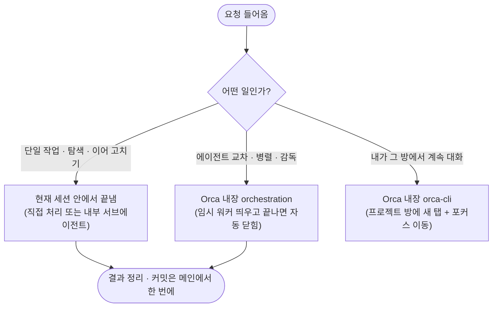

Case Study · Henry's Agentic System
회의실을 매번 새로 잡지 않기로 했다

하네스 규칙과 내장 오케스트레이션 스킬의 중복을 걷어내고 역할을 나눈 기록

> **3줄 요약**
> - 에이전트가 여럿 돌기 시작하면서 작업마다 새 세션을 띄우는 규칙을 넣었더니, 작은 일에도 시작 비용이 두 배로 들고 열린 탭과 작업 소유권 충돌만 쌓였다.
> - <mark>세션 안의 일은 하네스(규칙과 전문 에이전트)가 끝내고, 세션과 세션을 엮는 일만 Orca 내장 오케스트레이션 스킬에 맡기도록 역할을 나눴다.</mark>
> - 프로젝트 폴더 워크스페이스는 오케스트레이션 도구가 아니라 내가 직접 오가는 방으로만 남겼다.

**이런 분께 권해요** 🙋
- Claude Code, Codex 같은 여러 AI 에이전트를 한 화면에서 섞어 쓰는 분
- "멀티 에이전트 오케스트레이션"을 붙였는데 오히려 느려지고 복잡해진 분
- 워크스페이스 나누기와 서브에이전트 호출 기준을 깔끔하게 정리하고 싶은 분

> "어, 이거 그냥 내장 오케스트레이션이 알아서 하면 되는 거 아닌가?"

9월에 하네스를 한 차례 줄이고 나서도 내 작업 환경은 계속 자랐다. PC에서는 여러 프로젝트가 동시에 돌기 시작했고 어느 날부터는 Claude 혼자 아니라 Codex와 Antigravity까지 한 도구(Orca) 안에서 번갈아 부르게 됐다.

자연스럽게 욕심이 생겼다. 메인이 일감을 받으면 프로젝트별로 새 세션을 띄워서 일을 시키고 끝나면 보고받는 구조를 내 손으로 규칙 문서에 꾹꾹 눌러 담았다. 막상 하루 이틀 굴려 보니 묘한 기분이 들었다. 도구가 이미 갖춘 기능을 내가 문서로 또 덮어쓰고 있었던 거다.

---

## 🤯 왜 매번 새 회의실부터 잡았을까?

비유하자면 이랬다. 우리 회사에는 이미 **사내 메신저와 회의실 배정 시스템(Orca 내장 오케스트레이션 스킬)**이 깔려 있었다. 그런데 내가 회사 **업무 매뉴얼(하네스 문서)** 안에 "회의실 예약 버튼 누르는 법"을 따로 적어 두고 심지어 1분짜리 단순 질문이 와도 무조건 새 회의실을 잡으라고 적어 놓은 셈이다.

실제로 돌려 보니 세 가지 군데서 삐걱거렸다.

1. **기본 입장료가 매번 나갔다.** 새 세션을 하나 열 때마다 하네스 규칙을 처음부터 다시 읽어야 한다. 대화를 시작하기도 전에 이미 6만 6천에서 7만 토큰 안팎이 기본으로 나간다.
2. **쓸데없이 방이 쌓였다.** 작은 조사나 파일 한두 개 고치는 일까지 새 세션을 띄우니 화면에 끝난 탭이 줄줄이 남았다.
3. **서로 같은 파일을 건드렸다.** 여러 워커가 동시에 돌다가 작업 소유권(`consumer_fenced`)이 부딪히거나, 같은 원고를 두 세션이 중복으로 윤문하는 일도 벌어졌다.

도구를 믿고 맡기려고 만든 규칙이 오히려 발목을 잡고 있었다.

---

## 🧩 겹친 걸 걷어내고 역할을 셋으로 나눴다

고치는 기준은 단순했다. **"한 방 안에서 끝날 일"과 "방을 건너가야 할 일"을 구분하는 것.**

역할을 다시 적고 보니 세 층이 딱 맞아떨어졌다.

- **세션 안 (하네스)**: 어떤 톤으로 쓸지(`voice.md`), 어떤 글쓰기 규칙을 따를지, 어떤 전문 에이전트에게 초안을 맡길지는 하네스가 정한다. 단일 작업이나 문서 수정, 자료 조사는 새 세션을 열지 않고 지금 열린 방에서 바로 끝낸다.
- **세션 간 (Orca 내장 스킬)**: Claude에서 Codex로 코드 리뷰를 넘기거나, 서로 안 겹치는 두 작업을 동시에 돌려 결과만 모아 올 때는 Orca 내장 `orchestration` 스킬을 부른다. 일회성 워커는 일이 끝나면 탭이 알아서 닫힌다.
- **사이드바 (프로젝트 방)**: 논문, 포트폴리오, 진행 중인 주요 프로젝트처럼 내가 며칠씩 매달려 오가는 주제만 폴더 워크스페이스로 나눠 둔다. Git 복제(약 1.4GB)나 브랜치 분기 없이 작업 경로와 해당 프로젝트 규칙만 깔끔하게 분리된다.

바꾸기 전과 후를 나란히 놓아 보니 차이가 바로 보였다.

| 기준 | 바꾸기 전 (이중 규칙) | 바꾼 후 (역할 분리) |
|---|---|---|
| 작은 일 · 단순 조사 | 건마다 새 워커 세션 생성 (7만 토큰 안팎 추가) | 현재 세션 또는 내부 서브에이전트로 바로 끝냄 |
| 오케스트레이션 절차 | 하네스 문서에 CLI 명령어를 직접 정의 | Orca 버전별 내장 스킬(`orchestration` · `orca-cli`)을 정본으로 사용 |
| 일회성 워커 탭 | `--keep-open`으로 남아 수동으로 닫아야 함 | 보고가 끝나면 자동 종료 |
| 폴더 워크스페이스 | 작업 분배를 위한 세분화 시도 | 사람이 오래 드나드는 주력 프로젝트 방 구분용으로만 유지 |

---

## 🚪 실제로 내가 쓰는 하루 흐름

복잡한 규칙을 외우지 않아도 되니 쓰는 법도 네 가지로 줄었다.

1. **평소엔 `DEV main` 하나를 창구로 둔다.** 가벼운 질문, 공통 문서 수정, 여러 방에 걸친 병렬 작업은 메인에서 바로 시킨다.
2. **병렬이나 다른 에이전트가 필요할 때만 말로 시킨다.** "이건 둘로 나눠서 병렬로 돌리고 결과만 모아 줘", "Codex한테 리뷰 시키고 보고받아 줘"라고 말하면 Orca가 알아서 워커를 띄웠다가 정리한다.
3. **특정 방에 들어가 오래 대화할 땐 포커스만 넘긴다.** "논문 방에 새 세션 열어서 넘어가자"라고 하면 메인이 해당 워크스페이스에 새 탭을 띄우고 화면 포커스(`--focus`)까지 바로 옮겨 준다.
4. **어제 하던 대화를 이어갈 땐 사이드바에서 그 방을 바로 누른다.** 이미 열려 있던 방에 말을 보탤 때는 거칠 것 없이 바로 들어가는 편이 가장 빠르고 0원이다.

마무리 커밋("깃")만 여전히 메인에서 한 번에 챙긴다. 워커마다 각자 Git 인덱스를 건드리면 엉키기 때문이다.

---

## 🌱 도구가 잘하는 일은 도구에게

예전에는 내가 만든 하네스 안에 모든 규칙과 실행 방법을 다 넣어야 안심이 됐다. 그런데 도구가 진화해서 세션 간 조율과 메신저 역할을 내장 스킬로 잘 해낸다면, 내 매뉴얼은 **무엇을 어떤 기준으로 만들지**만 정해 두면 된다.

마치 잘 맞는 팀으로 일할 때 팀장이 회의실 예약 버튼 누르는 법까지 매뉴얼로 쓰지 않는 것과 같다. 9월의 다이어트가 안 쓰는 직원을 줄이는 일이었다면, 이번 정리는 도구가 이미 맡아 줄 수 있는 일을 내 문서에서 내려놓는 일이었다. 🧭

더 자세한 하네스 구조와 변경 이력은 위키에 함께 올려 뒀다.

- [Henry Agentic System](/wiki/entity-henry-agentic-system/): 11월 개편이 반영된 전체 하네스 구조

#오케스트레이션 #멀티에이전트 #ClaudeCode #Codex #하네스엔지니어링 #자동화
