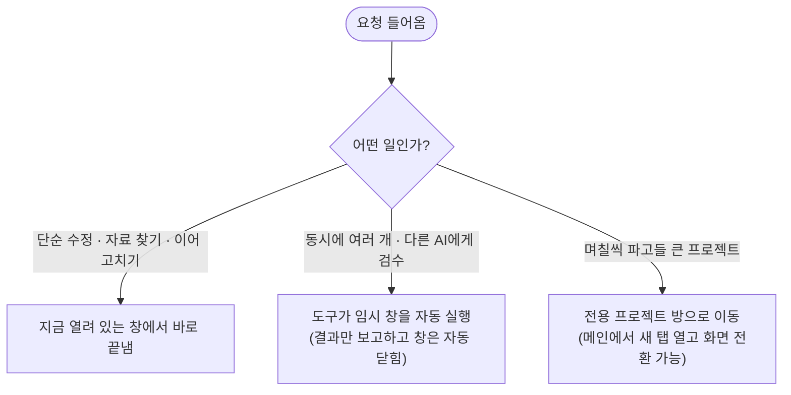

Case Study · Henry's Agentic System
회의실은 꼭 필요할 때만 잡기로 했다

매번 새 AI 창을 띄우다가 꼬여 버린 작업 흐름을 역할 분리로 풀어낸 기록

> **3줄 요약**
> - AI 여러 개를 쓰면서 일마다 새 창을 띄워 시켰더니 간단한 수정에도 시작 비용이 두 배로 들고 화면에 끝난 탭만 쌓였다.
> - <mark>혼자 끝낼 일은 지금 창에서 바로 처리하고 여러 AI를 동시에 돌리거나 서로 검수시킬 때만 도구가 알아서 임시 창을 띄웠다 닫게 바꿨다.</mark>
> - 프로젝트별로 나눈 폴더 방은 일 분배용이 아니라 내가 며칠씩 오가며 대화할 자리 구분용으로만 남겼다.

> "어, 이거 그냥 도구가 알아서 해 주는 건데 내가 규칙으로 또 막고 있었네?"

요즘 내 작업 화면에는 AI가 한 명만 있지 않다. 글과 문서를 정리할 때 주로 쓰는 Claude 말고도 코드를 고치거나 검증할 때 부르는 Codex, 화면과 흐름을 함께 챙기는 Antigravity까지 한 데스크톱 앱(Orca) 안에서 번갈아 쓰고 있다. 여러 에이전트가 한 화면에 모여 있다 보니 자연스럽게 욕심이 생겼다. 가운데 대표 창 하나를 세워 두고 내가 무슨 일을 시키든 무조건 프로젝트별 새 창을 열어서 일을 넘기게 규칙을 적어 둔 거다. 이렇게 해 두면 알아서 척척 분업이 돌아갈 줄 알았다.

## 🤯 잘 나눈 줄 알았는데 오히려 꼬여 버렸다

막상 이틀 정도 굴려 보니 전혀 깔끔하지 않았다. 오타 하나 고치자고 말을 걸어도 새 창이 열렸고 창이 새로 열릴 때마다 AI는 내 작업 규칙과 말투 문서를 처음부터 다시 읽어야 했다. 대화를 시작하기도 전에 이미 6~7만 토큰(대략 책 수십 쪽 분량의 설명서를 매번 다시 꺼내 읽는 비용)이 기본 입장료로 빠져나갔다.

화면 위쪽에는 끝난 탭이 줄줄이 쌓이기 시작했다. 일이 끝나도 내가 일일이 닫기 전까지는 창이 그대로 남아 있어서 나중엔 어느 창에서 뭘 시켰는지 찾는 일부터가 피곤해졌다. 더 곤란했던 일도 있었다. 한쪽에서 글을 다듬는 사이에 다른 창이 또 열려서 같은 파일을 동시에 건드리며 작업이 꼬였다. 잘 나눠서 쓰려고 만든 규칙이 오히려 일을 두 번 하게 만들고 있었다.

## 🏢 매뉴얼에 회의실 예약법까지 적어 둔 셈이었다

이걸 회사 사무실에 비유해 보면 원인이 금방 보인다. 내 작업 환경에는 역할을 정하는 세 가지 층이 있다. 어떤 말투로 쓰고 어떤 기준으로 검수할지 적어 둔 **업무 매뉴얼(하네스)**이 있고 필요할 때만 임시 작업창을 열어서 일을 시키고 끝나면 닫아 주는 **사내 메신저와 회의실 배정판(Orca 내장 오케스트레이션)**이 있다. 여기에 논문이나 포트폴리오처럼 내가 며칠씩 매달리는 큰 주제를 따로 모아 둔 **전용 책상(프로젝트 방)**이 더해진다.

내가 뭘 겹치게 만들었냐면 업무 매뉴얼 안에 회의실 예약 버튼 누르는 법까지 따로 적어 두고 심지어 1분짜리 단순 질문이 와도 무조건 새 회의실을 잡으라고 적은 거다. 앱 안에 이미 회의실 배정판이 내장되어 있는데도 내 문서로 그 기능을 이중으로 덮어쓰고 있었다. 그래서 규칙에서 겹치는 절차를 덜어 내고 언제 지금 창에서 끝내고 언제 새 창을 띄울지 선을 다시 그었다.

## 🚪 이제는 이런 리듬으로 굴러간다

규칙을 덜어 내고 나니 하루에 AI를 쓰는 흐름도 훨씬 자연스러워졌다. 자료 조사나 짧은 수정은 물론 어제 쓰던 글을 이어서 다듬는 일까지 새 창을 띄우지 않고 지금 열려 있는 창에서 바로 끝낸다. 잠깐 자료를 훑어야 할 때도 AI가 자기 안에서 조용히 조사만 나눠 처리하고 결과만 건네주니 탭이 불어날 일이 없다.

진짜 분업이 필요할 때만 말로 지시한다. "이건 두 갈래로 동시에 정리해서 결과만 모아 줘"라거나 "Codex한테 리뷰 맡기고 결과 가져와"처럼 여러 AI를 동시에 돌리거나 다른 AI의 눈이 필요할 때다. 그러면 도구의 내장 기능이 알아서 임시 창을 띄워 일을 시키고 메인 창에 요약만 보고한 뒤 그 임시 창은 스스로 닫는다. 덕분에 화면이 지저분해지지 않는다.

논문이나 포트폴리오처럼 며칠씩 이어 가는 큰 프로젝트는 왼쪽 목록의 전용 방에 모아 둔다. 이 방은 저장소를 통째로 복사하는 무거운 방식이 아니라 폴더 위치만 가볍게 나눈 자리라 방에 들어가는 순간 그 프로젝트 규칙이 바로 잡힌다. 메인 창에서 "논문 방에 새 창 열어서 넘어가자"고 하면 바로 그 방으로 화면을 옮겨 줄 수도 있고 어제 하던 대화를 이어 갈 땐 왼쪽 목록에서 그 방을 직접 누르는 편이 가장 빠르다.

| 기준 | 바꾸기 전 (이중 규칙) | 바꾼 후 (역할 분리) |
|---|---|---|
| 가벼운 질문 · 문서 수정 | 일마다 새 창 생성 (기본 로딩 비용 매번 발생) | 지금 열려 있는 창에서 바로 끝냄 |
| 병렬 작업 · 다른 AI 호출 | 하네스 규칙으로 수동 띄우기 · 수동 닫기 | 도구의 내장 기능이 띄우고 끝나면 자동 닫힘 |
| 전용 프로젝트 방 | 일 분배용으로 계속 늘리려 함 | 내가 직접 오가는 주력 주제만 유지 |

## 🌱 도구가 잘하는 일은 도구에게

예전에는 내가 만든 매뉴얼 안에 실행 방법까지 죄다 적어 두어야 마음이 놓였다. 그런데 도구가 자라서 여러 창을 띄우고 결과를 모으는 일까지 기본 기능으로 해낸다면 내 매뉴얼은 무엇을 어떤 기준으로 만들지만 정해 두는 편이 훨씬 가볍다.

잘 맞는 팀에서도 팀장이 회의실 예약 버튼 누르는 법까지 매뉴얼로 적어 두진 않는다. 9월에 안 쓰는 기능을 덜어 내는 다이어트를 했다면 이번 정리는 도구가 이미 잘해 내는 일을 내 규칙에서 내려놓는 일이었다. 🧭

이 글의 바탕이 된 전체 하네스 구조와 최신 변경 내역은 위키에도 함께 정리해 두었다.

- [Henry Agentic System](/wiki/entity-henry-agentic-system/): 하네스 전체 구조와 11월 개편 기록

---

**이런 분께 권해요** 🙋
- AI 여러 개를 같이 쓰면 무조건 빨라질 줄 알았다가 오히려 버벅거리는 걸 겪어 본 분
- "지금 채팅에서 이어 갈까, 새 창을 열어서 시킬까?" 매번 고민해 본 분
- 개발자용 AI 도구를 혼자서도 조용한 팀처럼 굴려 보고 싶은 분

#오케스트레이션 #멀티에이전트 #ClaudeCode #Codex #하네스엔지니어링 #자동화
