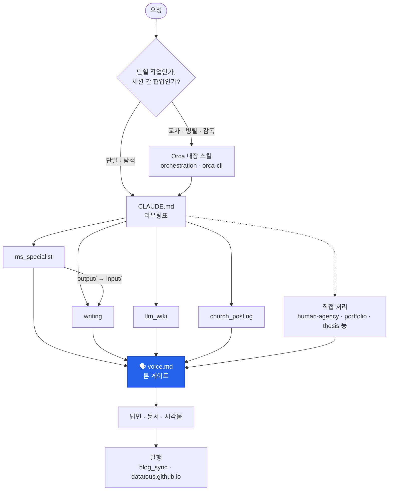

entity

## Summary
> **한 줄로**: 내가 Claude Code · Orca 위에 직접 만든 개인 자동화 하네스다. **폴더 하나가 작업자(워커) 한 명**이고, 단일 작업은 현재 세션에서 바로 끝내고, 여러 에이전트를 섞거나 병렬로 돌릴 때만 Orca 내장 오케스트레이션 스킬을 부른다. 2026-11-28 기준 워커 폴더 11(휴면 6 별도) · 에이전트 10(+ 벤더링 3) · 스킬 14 · 훅 1.

사무실에 비유하면 이렇다. 워커는 각자 자기 책상(폴더)에서 일하고, 앞사람이 `output/` 트레이에 서류를 두면 뒷사람이 `input/` 트레이에서 가져간다. 9월 v12에서는 하네스 내부의 별도 안내데스크(supervisor 에이전트)를 없애고 `CLAUDE.md` 라우팅표 한 장으로 줄였다. 11월에는 여기에 모델 라우팅과 클라우드·PC 공통 규칙을 얹고, 세션 간 협업만 **Orca 내장 오케스트레이션**에 맡기도록 역할을 나눴다.

## Key Facts
- **2계층 실행 구조 (세션 안 하네스 + 세션 간 Orca)**: 단일 작업과 탐색은 현재 세션(직접 처리 또는 내부 서브에이전트)이 끝낸다. `claude` · `codex` · `antigravity`처럼 에이전트를 교차하거나 병렬 감독이 필요할 때만 Orca 내장 `orchestration` · `orca-cli` 스킬로 세션을 띄운다.
- **폴더 워크스페이스 = 프로젝트 방 구분**: 오케스트레이션 때문에 작은 일마다 워크스페이스를 만들지 않는다. 사람이 장기간 드나드는 주력 프로젝트(논문, 포트폴리오, 주요 프로젝트)만 폴더 워크스페이스로 나눠 Git 복제 없이 작업 경로와 맥락을 분리한다.
- **라우팅 SSOT = `CLAUDE.md` 표 하나**: 라우터 에이전트를 한 단 더 거치면 컨텍스트가 두 번 쌓인다.
- **정의는 한 벌 + 외부 스킬 벤더링**: 에이전트는 `.claude/agents/*.md`, 스킬은 `.claude/skills/*/SKILL.md`에 두고, 의존하는 외부 스킬(`humanize-korean`, `frontend-design`)은 리포에 내장해 PC와 클라우드 세션이 같은 규칙·스킬을 쓴다.
- **틀렸을 때 비용 기반 모델 라우팅**: `haiku` · `sonnet` · `opus` · `fable` 등급으로 나누고, 싼 모델이 실행한 뒤 막힐 때만 상위 모델에 묻는 advisor 패턴과 캐스케이드를 적용했다.
- **훅 1개 + 점검 분리**: 음성 모드 훅·MCP를 내리고 프로젝트 `.claude/settings.json`에는 클라우드 안내용 `SessionStart` 1개만 남겼다. 스크립트 점검(`weekly_check.py`)은 OS 스케줄러가 토큰 0원으로 돌리고, 세션 마감 점검은 보조 봇 자동 실행이 맡는다.
- **세션 고정 로딩 21,181자 / 예산 20,000자**: `.claude/rules/` 4종과 라우팅 확장이 얹힌 2026-11-28 실측값이다. 구조 정합성은 `python tools/harness_map.py --check`로 자동 검사한다.

## Details

### 요청 하나가 흐르는 길 (2026-11-28 기준)

- **워커별 담당 에이전트**: `ms_specialist` → `update-tracker-agent`, `writing` → `write-for-me` · `write-for-company`, `llm_wiki` → `wiki-ingest` · `wiki-query` · `wiki-lint`, `church_posting` → `church-poster`, 특정 프로젝트 전담 에이전트 1종. `human-agency` · `portfolio` · `thesis` · `wedding` · `finance`는 메인 세션이 직접 처리하거나 공용 에이전트를 조합한다.
- **웹 조사는 `research-agent`가 공용으로** 맡는다. Write · Bash 권한을 빼서 비신뢰 웹 콘텐츠를 격리한다.
- **모든 산출은 `knowledge/voice.md`를 거친다.** 글이면 `writing-styles.md`와 `humanize-korean`, 시각물이면 `frontend-design` · `clear-artifact`가 붙는다.
- 라우팅표 원문은 여기 옮겨 적지 않는다. 정본은 `CLAUDE.md`다.

### 지금 물려 있는 것 (2026-11-28 실측)

| 구분 | 수 | 구성 요약 |
|------|----|-----------|
| 워커 폴더 | 11 | 상시·도메인 워커 9 + 연재 종료 1(`automation-series`) + 라우팅 제외 1(`memo`) |
| 에이전트 | 10 (+3) | 도메인·공용 에이전트 9 + 프로젝트 전담 1 (+ 벤더링 윤문 에이전트 3종) |
| 스킬 | 14 | 글·발행·윤문(4)·위키·로그·시각물·점검·자료 빌더 등 |
| 파이프라인 | 3 | `ms_specialist → writing`, `writing → tools/blog_sync`, `llm_wiki → datatous.github.io` |
| 프로젝트 훅 | 1 | 클라우드 안내용 `SessionStart` 1개 (음성 훅 2종 비활성화) |
| 휴면 워커 | 6 | `ppt_team_agent` · `data_analysis` · `ideaing` · `retrospective` · `higgsfield` · `daily_brief` |

### 메모리: 4가지 타입

Claude Code 자동 메모리(`~/.claude/projects/<프로젝트>/memory/`)와 리포 공용 규칙(`.claude/rules/`)을 함께 쓴다. 오래 갈 피드백은 리포 `.claude/rules/feedback.md`로 올려 PC와 클라우드 세션이 함께 읽도록 맞췄다.

- `user`: 나에 대한 것(역할, 선호, CLI 숙련도)
- `feedback`: 내가 교정하거나 확인해 준 작업 방식. 오래 갈 규칙은 리포로 승격
- `project`: 진행 중인 일의 상태·기한
- `reference`: 외부 시스템 포인터와 도구 함정

### 공개 위키 발행: llm_wiki → datatous.github.io

`python tools/blog_sync/publish_wiki.py` 한 줄이 변환(`wiki_to_blog.py`)부터 블로그 repo 커밋·푸시까지 한다.

- **fail-closed**: 프론트매터에 `visibility: public`이 없으면 안 나간다.
- **공개본은 읽기 좋게 가공한다**. `위키링크`는 실제 링크로 바꾸고, 출처 태그는 페이지 끝 "근거 자료" 한 줄로 모은다. Mermaid 블록은 사이트에서 그림으로 렌더된다.
- **발행은 한 체크아웃에서만**: 변환기는 원본에 없는 공개 페이지를 지우므로 정본 체크아웃 한 곳에서만 발행한다.

### 걸어온 길

| 시점 | 구조 |
|------|------|
| 2026-05 | Orchestrator + Worker. 라우터 에이전트가 요청을 받아 워커로 분배 |
| 2026-08-21 | 사수/부사수(producer-reviewer) 폐기, 5개월 가동률 0% |
| 2026-09-08 | "hook 다 꺼", 3개 scope의 command 24개 비활성화 |
| 2026-09-23 | **v12**: Codex 미러·supervisor 폐기, 워커 14→9, `harness_map.py`, 톤 SSOT |
| 2026-11-19 | 규칙 SSOT 리포 이관, 외부 스킬 벤더링, 모델 라우팅 도입 |
| 2026-11-25 | 음성 훅 비활성화(11/21), `human-agency` 신설 · `automation-series` 연재 종료 |
| 2026-11-28 | **오케스트레이션 역할 분리**: 하네스 이중 절차 제거, 세션 안 직접/서브에이전트 우선 + 세션 간 협업만 Orca 내장 스킬 사용, 폴더 워크스페이스는 프로젝트 방 구분용으로 유지 |

어떻게 줄였는지는 [하네스 다이어트: 실측으로 워커를 내리는 법](/wiki/concept-harness-diet-measurement-driven-pruning/)에, 줄인 구조를 어떻게 지키는지는 [그림도 검사 대상으로: 실측에서 생성하는 배선도](/wiki/concept-generated-diagrams-as-consistency-checks/)에 따로 정리했다.

## Connections
- → [하네스 다이어트: 실측으로 워커를 내리는 법](/wiki/concept-harness-diet-measurement-driven-pruning/) : 14개까지 늘었던 워커를 줄이고 유지하는 방법
- → [그림도 검사 대상으로: 실측에서 생성하는 배선도](/wiki/concept-generated-diagrams-as-consistency-checks/) : `harness_map.py --check`와 자동 생성 배선도
- → [Harness Engineering](/wiki/concept-harness-engineering/) : 이 시스템이 따르는 상위 관점
- → [12 Agentic Harness Patterns](/wiki/concept-12-harness-patterns/) : 패턴 목록
- → [Claude Code Architecture](/wiki/concept-claude-code-architecture/) : 기반 아키텍처
- → [메일 첨부파일 자동화의 MCP 제약과 우회 경로](/wiki/concept-mail-attachment-automation-constraint/) : 개인 데이터 파이프라인을 붙일 때의 제약
- → [로컬 음성 에이전트 파이프라인 구성 패턴 (Windows)](/wiki/concept-local-voice-agent-pipeline/) : 음성 입출력 확장의 상세(2026-11-21 이후 비활성화)
- → [네이버 메일 IMAP 연동 — 인증 강제와 인코딩 함정](/wiki/concept-naver-mail-imap-integration/) : 읽기 전용 메일 조회 도구와 구현 함정

## Open Questions
- 세션 고정 로딩이 21,181자로 예산(20,000자)을 +1,181자 넘긴 상태라 `CLAUDE.md`와 `.claude/rules/feedback.md`의 경량화 여지가 남아 있다.
- 워커 간 `output/ → input/` 전달은 메인 세션이 직접 이어 준다.
- 토큰 사용량은 세션 단위로만 보며 워커별 비용 대시보드는 없다.

<b>근거 자료</b> <code>023-harness-v12-orchestration-slimming-2026-09-23.md</code> · <code>034-harness-v13-orca-orchestration-update-2026-11-28.md</code> · <code>026-harness-v12-technical-details-2026-09-23.md</code> · <code>024-harness-generated-diagram-check-gate-2026-09-23.md</code> · <code>007-harness-claude-md-snapshot.md</code> · <code>025-wiki-publish-pipeline-fixes-2026-09-23.md</code>

